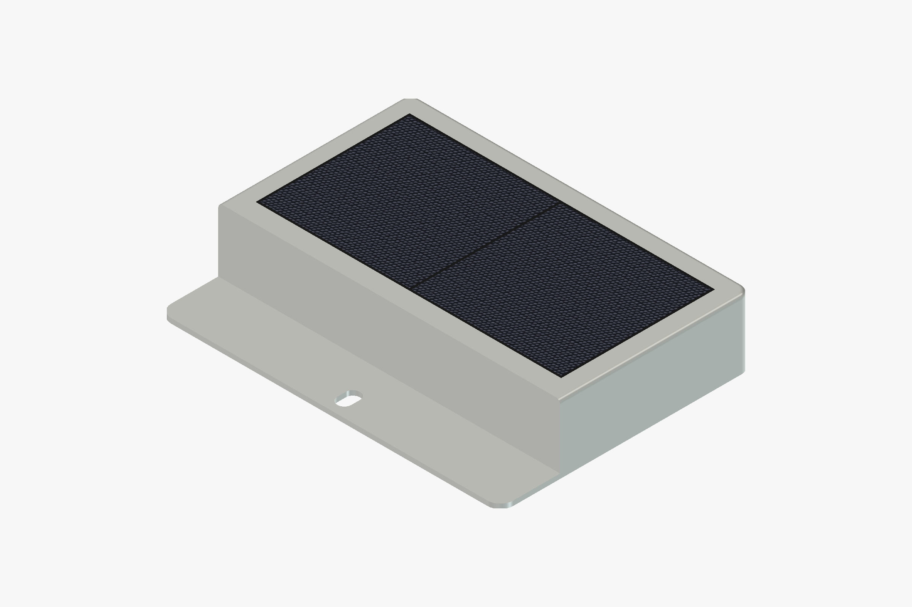
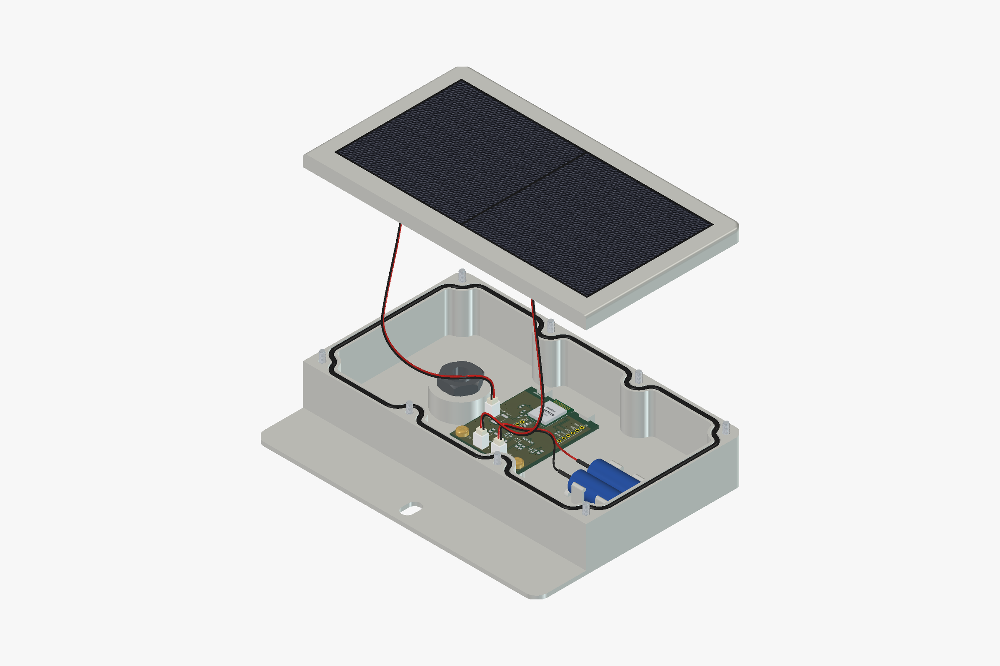
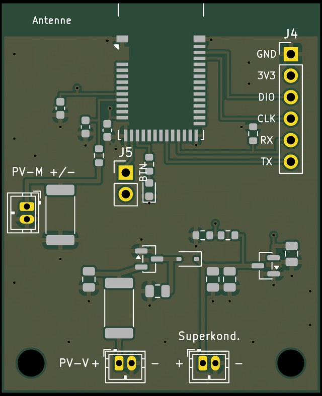
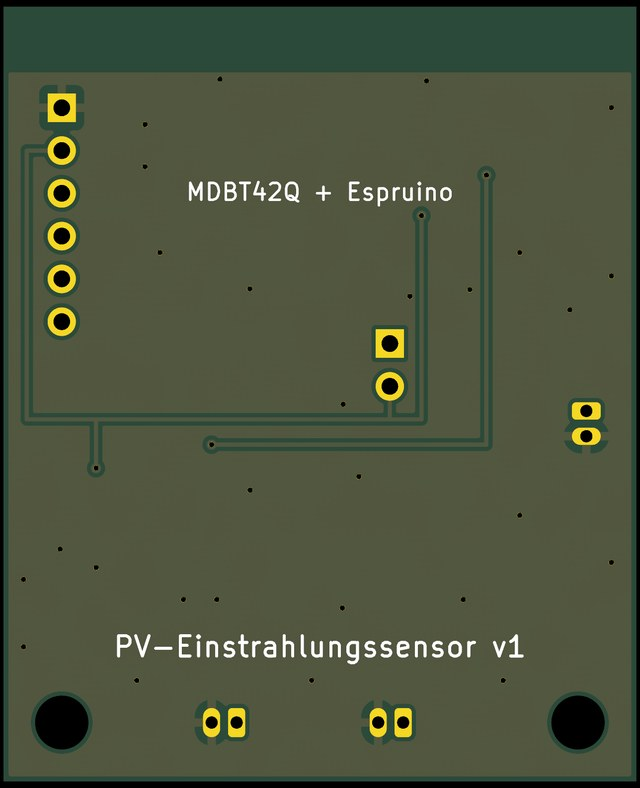
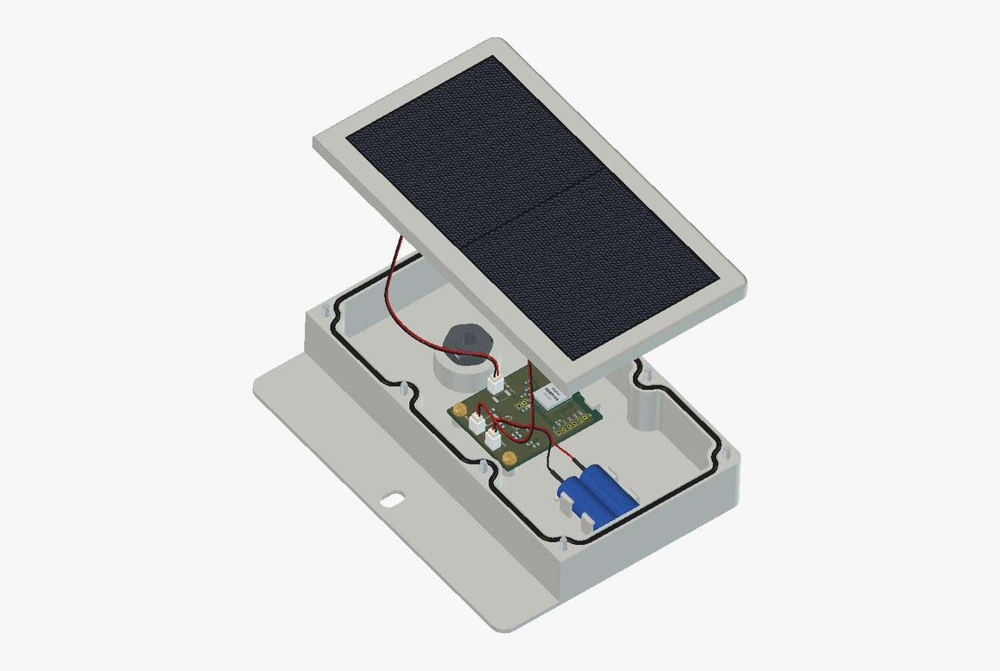
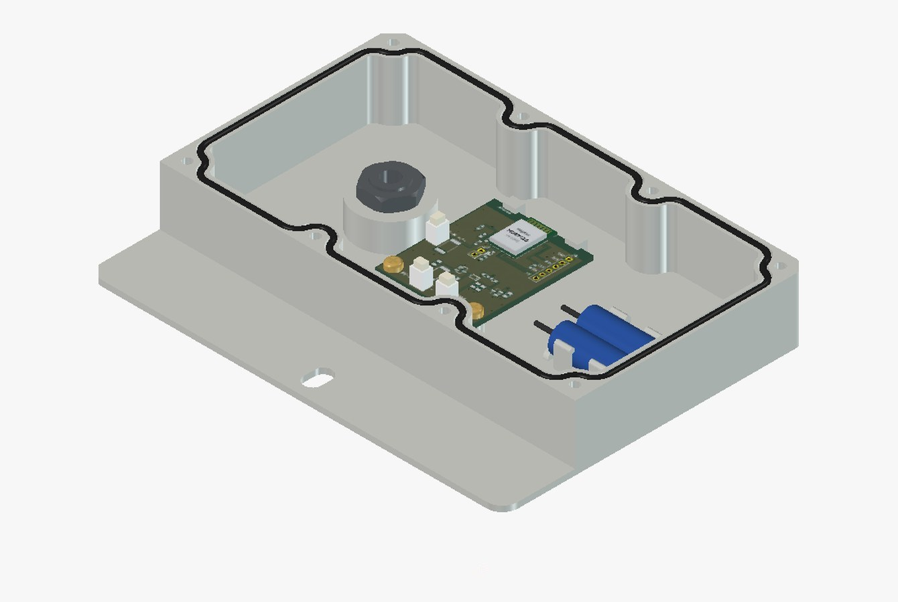
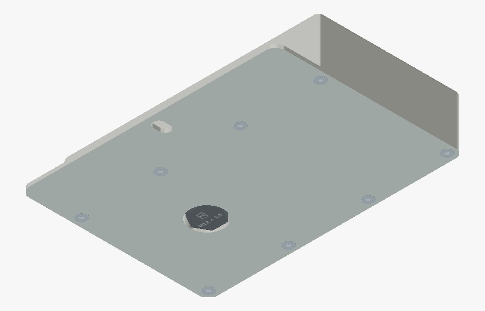
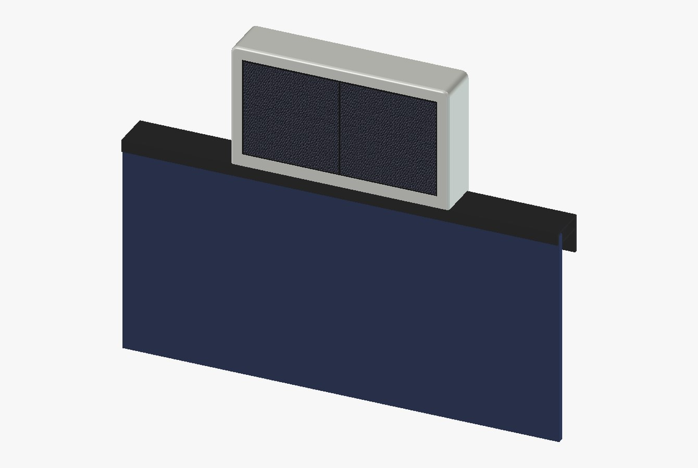
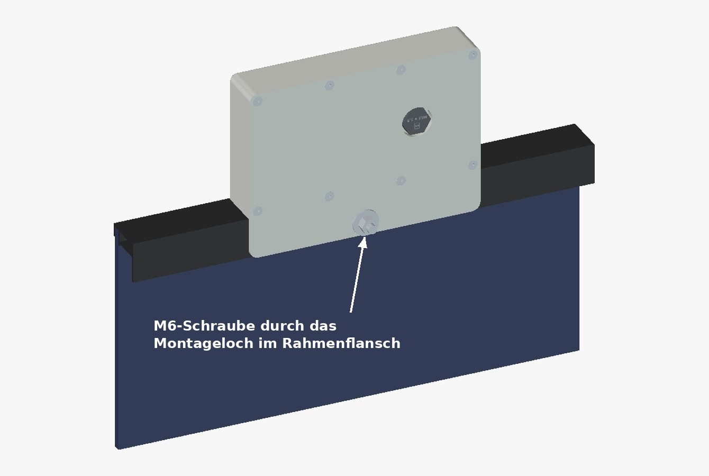

# PV-Einstrahlungssensor

Ein kabelloser Sensor, der die Sonneneinstrahlung **in der Ebene einer PV-Fläche** misst – auch dann, wenn der Wechselrichter abregelt. Ein kleines Solarmodul arbeitet als Messzelle, ein zweites versorgt die Elektronik über einen Superkondensator. Die Werte gehen per [BTHome](https://bthome.io) an Home Assistant, ganz ohne Akku, Batterie oder Kabel.

<p>
  
  
</p>

> **Stand: Entwurf (November 2026).** Platine, Gehäuse und Programm sind fertig konstruiert und rechnerisch geprüft, aber **noch nicht gebaut**. Was am ersten Exemplar zu prüfen ist, steht unter [Offene Punkte](#offene-punkte). Nachbau auf eigenes Risiko.

**English summary:** A wireless, battery-free irradiance sensor for balcony/rooftop PV. A 70 mm ETFE solar cell operated near short circuit across a 10 Ω shunt measures plane-of-array irradiance; a second cell charges a 4 F supercapacitor. An Espruino-powered Raytac MDBT42Q (nRF52832) broadcasts the readings as BTHome v2, received by Home Assistant via Shelly Bluetooth proxies. Includes a scripted KiCad 9 PCB (38 × 46 mm, JLCPCB-ready), a parametric FreeCAD enclosure (PETG, O-ring sealed, membrane vent, printed tab that bolts to the panel frame flush with its front edge) and the Espruino program. A section compares other radio links (Wi-Fi, Zigbee, 868 MHz GFSK and LoRa) for larger rooftop arrays without a Bluetooth receiver nearby. Documentation is in German.

---

## Inhalt

- [Wozu?](#wozu)
- [Funktionsprinzip](#funktionsprinzip)
- [Überblick](#überblick)
- [Elektronik](#elektronik)
- [Platine](#platine)
- [Gehäuse](#gehäuse)
- [Programm (Espruino)](#programm-espruino)
- [Home Assistant](#home-assistant)
- [Abgleich](#abgleich)
- [Einkaufsliste](#einkaufsliste)
- [Aufbau und Montage](#aufbau-und-montage)
- [Offene Punkte](#offene-punkte)
- [Warum so und nicht anders](#warum-so-und-nicht-anders)
- [Andere Funkwege](#andere-funkwege)
- [Ordnerstruktur](#ordnerstruktur)
- [Lizenz](#lizenz)

---

## Wozu?

Eine PV-Anlage mit Speicher regelt ab, sobald der Akku voll ist und im Haus wenig verbraucht wird. Ab dann zeigt die Leistung des Wechselrichters nur noch, was abgenommen wird, und nicht mehr, was die Sonne hergeben würde. Damit fehlt die Grundlage für alles, was auf die **mögliche** Leistung reagieren soll: Überschussladen, Prognosen abgleichen, Verschattung oder Verschmutzung erkennen.

Der Sensor misst diese Größe direkt. Weil er in derselben Ebene wie das Paneel sitzt, sieht er dieselbe Einstrahlung, also Sonnenstand, Neigung, Ausrichtung und Wolken genauso wie das große Modul.

Für die eigene Anlage sind **drei** Sensoren vorgesehen, je einer pro Fläche:

| Sensor  | Paneele | Azimut | Neigung zur Waagerechten |
|---------|---------|--------|--------------------------|
| Süd     | 1 und 2 | 180°   | 55°                      |
| Südwest | 4       | 236°   | 65°                      |
| West    | 3       | 260°   | 65°                      |

Ein einziger Sensor und eine Umrechnung über die Geometrie hätten nicht genügt: Paneel 3 und 4 sind gleich steil, zeigen aber 24° auseinander, und das Verhältnis ihrer Erträge schwankte im Herbst zwischen 1,2 und 3,2.

## Funktionsprinzip

Eine Solarzelle liefert im Kurzschluss einen Strom, der sehr genau proportional zur Einstrahlung ist. Die Spannung hängt dagegen kaum davon ab. Der Sensor lässt das Messmodul deshalb fast im Kurzschluss auf einen 10-Ω-Widerstand (Shunt) arbeiten und misst die Spannung daran:

- 0,8-W-Modul, Kurzschlussstrom 143 mA bei 1.000 W/m²
- 143 mA × 10 Ω = **1,43 V bei 1.000 W/m²**, also rund **699 W/m² pro Volt**
- Selbst bei 1.300 W/m² (Sonne plus Reflexion von Wolkenrändern) sind es erst 1,86 V. Das ist ein Viertel der Leerlaufspannung, die Zelle bleibt im linearen Bereich (Abweichung < 0,5 %).

Ein zweites, baugleiches Modul lädt einen Superkondensator, aus dem das Funkmodul lebt. Messung und Versorgung sind getrennt, damit der Ladestrom die Messung nicht verfälscht.

## Überblick

| | |
|---|---|
| Messgröße | Einstrahlung in der Modulebene, W/m² |
| Messzelle | ETFE-Solarmodul 70 × 70 mm, 0,8 W, auf 10-Ω-Shunt |
| Versorgung | zweites Modul → 5-V-Regler → Superkondensator 5,5 V / 4 F → 3,3 V |
| Funk | BTHome v2 (Bluetooth LE Advertising), unverschlüsselt |
| Funkmodul | Raytac MDBT42Q (nRF52832) mit vorinstalliertem Espruino |
| Takt | messen alle 3 s, senden jede Sekunde |
| Verbrauch | ≈ 40 µA im Mittel, Kondensator überbrückt ≈ 2 Tage Dunkelheit |
| Kaltstart | ≈ 6 min bei bedecktem Himmel (200 W/m²) |
| Platine | 38 × 46 mm, 2 Lagen, SMD-Bestückung durch JLCPCB |
| Gehäuse | 3D-Druck (PETG), 160 × 90 × 32,2 mm, O-Ring-gedichtet, Druckausgleichselement, angedruckte Lasche für den Paneelrahmen |
| Kosten | rund 90 € für einen Sensor, jeder weitere rund 50 € |

## Elektronik

```
VERSORGUNG
  Modul V (J1) ─ R2 10 Ω ─ U1 HT7550 (5,0 V) ─ D1 B5819WS ─┬─ VCAP ≤ 4,8 V ── J3: Superkondensator 4 F / 5,5 V
                C1 10 µF        C2 10 µF                 │   C3, C4 2 × 22 µF
                                                         ├─ R4 1 MΩ ─┬─ R5 1 MΩ ─ GND
                                                         │           └─ DIV → P0.30 (D30), C9 100 nF
                                                         └─ U2 XC6206 (3,3 V) ─ 3V3 → MDBT42Q
                                                               C6 10 µF, C7 100 nF
MESSUNG
  Modul M (J2) ─┬─ R1 10 Ω, 2 W (Shunt) ─ GND
                └─ R3 10 kΩ ─ SENSE 0 … 1,9 V → P0.31 (D31), C8 100 nF

MDBT42Q (U3):  P0.00 (D0) Taster-Ersatz J5 · P0.01 (D1) LED D2 über R6 1 kΩ
               RX mit R7 1 MΩ nach GND · SWD, RX, TX auf J4
```

- **R2** vor dem 5-V-Regler nimmt dem kleinen SOT-23-Gehäuse bei vollem Ladestrom die Wärme ab (sonst bis zu 0,2 W im Regler).
- **D1** verhindert, dass sich der Kondensator nachts über Regler und Modul entlädt.
- **R4/R5** teilen die Kondensatorspannung durch zwei (Querstrom 2,4 µA).
- **R7** hält RX auf Masse, damit Espruino beim Start nicht versehentlich die serielle Konsole statt Bluetooth wählt.
- Taster und LED liegen wie auf dem offiziellen Espruino-Breakout an D0 und D1, Programme und Anleitungen dafür passen also unverändert.
- Ruhestrom beider Regler zusammen ≈ 3 µA (HT7550 1,5 µA, XC6206 1 µA).

**Anschlüsse** (eckiges Pad = Pin 1, bei J1–J3 also Plus):

| | Belegung | Wofür |
|---|---|---|
| J1 | + / −, ZH-Buchse 1,5 mm | Modul V (Versorgung), Stecker des Moduls direkt |
| J2 | + / −, ZH-Buchse 1,5 mm | Modul M (Messung), Stecker des Moduls direkt |
| J3 | + / −, ZH-Buchse 1,5 mm | Superkondensator über ein konfektioniertes ZH-Kabel |
| J4 | GND, 3V3, SWDIO, SWDCLK, RX, TX | Notfall: serielle Konsole oder SWD-Programmer |
| J5 | D0 / 3V3 | Taster-Ersatz: beim Einschalten überbrücken, um gespeicherten Code zu umgehen |

J4 und J5 sind Lötaugen im Raster 2,54 mm.

## Platine

| Oberseite | Unterseite |
|---|---|
|  |  |

Zwei Lagen, 38 × 46 mm, alle Bauteile oben. Die Antenne des Funkmoduls sitzt an der Oberkante, darunter bleibt ein 4 mm breiter Streifen auf beiden Lagen kupferfrei. Links die Messung, unten die Versorgung, rechts die Programmierleiste. Die Unterseite ist eine durchgehende Massefläche. Die Entwurfsregelprüfung (DRC) von KiCad meldet **0 Fehler und 0 offene Verbindungen** (`drc.json`).

Die Platine wird vollständig per Skript erzeugt. Es gibt keinen Schaltplan in KiCad, die Netze stehen in `erzeuge_platine.py`.

```bash
cd Einstrahlungssensor-Platine
./erzeuge_fertigung.sh     # baut die Platine, DRC, Gerber-ZIP, BOM/CPL, Renderings
```

Voraussetzung: KiCad 9 mit Python-Modul `pcbnew` und `kicad-cli` (getestet mit 9.0.8 unter Kubuntu).

> Falle beim Skripten: Der Zonen-Füller stürzt auf einem frisch erzeugten `BOARD` ab. Das Skript speichert deshalb erst, lädt neu und füllt dann.

### Bestellen bei JLCPCB

1. `einstrahlungssensor-gerber.zip` hochladen. Die Vorgaben passen: 2 Lagen, 1,6 mm.
2. „PCB Assembly“ einschalten, Seite „Top“, z. B. 3 von 5 Platinen bestücken.
3. `jlcpcb-bom.csv` und `jlcpcb-cpl.csv` hochladen. Alle Teile haben LCSC-Nummern. J4, J5 und das Funkmodul fehlen mit Absicht.
4. Die ZH-Buchsen J1–J3 sind Durchsteckteile und stehen nicht in der Stückliste. Du lötest sie selbst ein (HC-ZH1.5-2A, LCSC C2845550, am einfachsten gleich mitbestellen).
5. **In der Bestückungsvorschau prüfen:** Polung von D1 (Kathodenstrich zu J3/C3) und D2, Lage von U1 und U2. JLCPCB dreht manche Bauteile anders als KiCad.

| Bauteil | LCSC | Hinweis |
|---|---|---|
| HT7550-1 (MSKSEMI), 5-V-Regler | C5379082 | Pin 1 GND, 2 VIN, 3 VOUT |
| XC6206P332MR, 3,3-V-Regler | C5446 | Pin 1 GND, 2 VOUT, 3 VIN (anders als der HT7550!) |
| 10 Ω, 1 %, 2 W, 2512 (R1, R2) | C414890 | |
| B5819WS Schottky (D1) | C7420331 | |
| HC-ZH1.5-2A, stehend (J1–J3) | C2845550 | Durchsteckteil, Maße wie JST B2B-ZR, nicht in der Stückliste: selbst einlöten |
| übrige R, C und LED | siehe BOM | Standardteile |

### Funkmodul und Buchsen auflöten

Die drei ZH-Buchsen J1–J3 von oben einstecken und von unten verlöten, das eckige Pad (Pin 1, Plus) beachten. Sie sind unkritisch, am besten nach dem Funkmodul, damit sie beim Löten des Moduls nicht im Weg sind.

Das MDBT42Q lötest du ebenfalls selbst auf (Pads im Abstand von 0,7 mm an der Kante):

1. Viel Flussmittel, feine Spitze, Entlötlitze für Brücken.
2. Eine Ecke heften, Lage prüfen, dann die gegenüberliegende Ecke, dann den Rest.
3. Antenne zur Oberkante, Pad 1 (Markierung) oben links.
4. Vor dem ersten Einschalten mit dem Multimeter prüfen, dass 3V3 und GND an J4 nicht kurzgeschlossen sind.

## Gehäuse



| Unterteil | Boden |
|---|---|
|  |  |

Zwei Druckteile, beide passen auf ein 180-mm-Druckbett (Prusa mini):

- **Außenmaß** 160 × 90 × 32,2 mm (Unterteil 25,0 mm, Deckel 7,2 mm), mit Lasche 160 × 118 mm. Innenraum 149,6 × 79,6 × 22,6 mm.
- **Deckel:** eine gemeinsame Tasche (143 × 72 × 3,0 mm) für beide Module. Die Module liegen auf einer 1 mm dicken Klebefuge und schließen **bündig** mit der Deckeloberseite ab. Abstandsnoppen auf dem Klebering (vier je Modul) legen die Fugendicke fest, Positionsnoppen an den Taschenwänden die Lage, zwei Distanznoppen halten 1 mm Abstand zwischen den Modulen. Unter jedem Modul ein Fenster für Kabel und Anschlussdose. Obere Außenkante mit R 2 abgerundet, außer zur Rahmenseite.
- **Dichtung:** geschlossener **O-Ring 148 × 2 mm, EPDM 70** (wetter-, UV- und ozonfest) als Axialdichtung in einer Nut von 2,8 × 1,5 mm (≈ 25 % Verpressung, 75 % Nutfüllung, 1,9 % Dehnung). Passend sind O-Ringe mit 146–150 mm Innendurchmesser.
- **Verschraubung:** acht Senkschrauben **M3 × 30** von unten durch Dome im Unterteil in Gewindeeinsätze M3 × 5,7 im Deckel (5 mm Gewindeeingriff). Die Nut läuft innen um die Dome herum, die Schraubenlöcher liegen also außerhalb der Dichtung.
- **Druckausgleich:** ein Membranelement **M12 × 1,5** sitzt versenkt in einer Tasche im Boden (Sechskant gegen Mitdrehen), innen mit einer Gegenmutter gekontert. Es lässt Luft durch, aber kein Wasser, und verhindert, dass das Gehäuse bei Temperaturwechseln Feuchtigkeit ansaugt.
- **Platine:** Die Antennenkante steckt in zwei Haltern mit Schlitz, die Unterkante liegt auf zwei Abstandshaltern (5 mm) und wird mit zwei Linsenkopfschrauben M3 × 6 (ISO 7045) befestigt, die sich ihr Gewinde im 2,6-mm-Loch selbst formen.
- **Superkondensator:** liegt zwischen zwei Stirnanschlägen (an der Drahtseite niedrig, die Drähte laufen darüber) und wird in zwei Schnappklammern gedrückt (federnde Arme mit Rastnase, 2,1 % Dehnung, für PETG unkritisch).
- **Befestigung:** Die Halterung ist für **quer oder hochkant verbaute Paneele** gedacht. Bei quer verbauten (lange Seite waagerecht) liegen die Montagelöcher in den Rahmenseiten oben und unten, der beste Platz für den Sensor ist **oben**: Dort sieht er denselben Himmel wie das Paneel, wird nicht von Brüstung, Geländer oder einer unteren Paneelreihe verschattet, und Regenwasser, Schnee und Schmutz laufen vom Paneel nach unten ab statt über den Sensor. Bei hochkant verbauten sitzt der Sensor seitlich an einer Langkante, am besten am oberen Montageloch. Das Gehäuse sitzt neben der oberen Langkante des Paneels und liegt mit der Wand direkt am Rahmen an. Eine Lasche (160 × 28 × 2,2 mm), in einem Stück mit dem Unterteil gedruckt, greift hinten unter den Fußflansch des Rahmens und wird mit **einer M6-Schraube durch ein Montageloch im Rahmenflansch** gehalten (Langloch ±2 mm). Gemeint sind die Montagelöcher, die gerahmte PV-Paneele ab Werk im Fußflansch der langen Rahmenseiten haben und die im Datenblatt des Paneels eingezeichnet sind. Gebohrt wird nichts. So liegt der Deckel **bündig mit der Rahmenvorderkante**: Das Gehäuse verschattet das Paneel nicht und der Rahmen nicht die Module. Die Wand am Rahmen verhindert das Verdrehen und trägt das Gewicht. Zur Rahmenseite haben Unterteil und Deckel keine Eckradien, damit sich kein Schmutz in Zwickeln sammelt. Die Lasche ist nur 2,2 mm dick, weil sie genau den Höhenunterschied zwischen Gehäuse (32,2 mm) und Rahmen (30 mm) ausfüllt. Sie hält trotzdem rund 340 N senkrecht zum Paneel, eine Sturmböe drückt mit 15–20 N. Rahmenmaße nach dem Datenblatt JA Solar JAM60D41 (langer Rahmen 30 mm hoch, Fußflansch 28 mm, Lochmitte 19 mm von der Außenfläche): Bei anderen Paneelen die Parameter `RAHMEN_*` und `MONTAGELOCH_ABSTAND` im Skript anpassen.

| Montiert, von vorn | Montiert, von hinten |
|---|---|
|  |  |

Alle Maße stehen als Parameter oben in `erzeuge_gehaeuse.py`. Neu erzeugen (FreeCAD 1.x, headless):

```bash
cd Einstrahlungssensor-Gehäuse
freecad.cmd erzeuge_gehaeuse.py     # → gehaeuse-unterteil/-deckel als STL und STEP
freecad.cmd pruefe_gehaeuse.py      # Passungsprüfung: Platine, Stecker, Kondensator, Druckausgleich
python3 vorschau.py                 # Vorschaubilder in Bilder/ (nur Pillow nötig)
```

Das Skript gibt beim Bauen die wichtigsten Kontrollmaße aus: Gewindeeingriff, Wandstärken an Einsätzen und Senkungen, Nutfüllung, O-Ring-Dehnung, Federweg der Schnappklammern. `pruefe_gehaeuse.py` meldet für den aktuellen Stand **0 Überschneidungen**.

`live_ansicht.py`, `live_uebernehmen.sh` und `live_befehl.sh` sind ein Hilfsmittel zum gemeinsamen Konstruieren: Das Makro läuft in der FreeCAD-Oberfläche, baut das Modell neu, sobald sich das Skript ändert, und zeigt Platine, Kabel, Schrauben und Module mit. Die Texturen dafür liegen im Ordner `Live-Ansicht/`, der nicht im Repository ist. Die Moduloberfläche erzeugt `erzeuge_modultextur.py`, die Platinenbilder kommen von `platine_ansicht_daten.py`. Für den Nachbau braucht man das alles nicht.

### Drucken

- **Material: PETG** in heller Farbe. Kein PLA, es wird ab etwa 55 °C weich: Die beiden schwarzen Solarzellen im eigenen Deckel heizen sich in der Sommersonne auf 60 °C und mehr auf, und das Gehäuse liegt zusätzlich direkt am Rahmen des PV-Paneels, der ebenso heiß wird. ASA wäre UV-fester, verzieht sich auf einem offenen Drucker bei 16 cm Länge aber leicht.
- **Lage:** Unterteil mit dem Boden aufs Bett, die Lasche liegt mit auf. Deckel mit der Tasche nach oben. Kein Stützmaterial.
- **Einstellungen:** 0,2 mm Schichthöhe, 4 Perimeter, 5 obere und untere Schichten, 25 % Gyroid. Die vielen Perimeter machen die Wände dicht.
- **Gewindeeinsätze:** Löcher 4,0 mm für M3 × 5,7 im Deckel, passend etwa zu Ruthex. Andere Einsätze → Maße im Skript anpassen.

## Programm (Espruino)

[`Firmware/einstrahlung-sued.js`](Firmware/einstrahlung-sued.js) misst alle 3 Sekunden beide Spannungen (16-fach gemittelt) und sendet sie jede Sekunde als BTHome-Advertising:

| BTHome-Objekt | Wert | Auflösung |
|---|---|---|
| `0x0C` voltage | Spannung am Shunt | 1 mV ≙ 0,7 W/m² |
| `0x4A` voltage | Spannung am Superkondensator | 0,1 V |

Espruino misst relativ zur Betriebsspannung. Das Programm rechnet deshalb mit `E.getAnalogVRef()` in Volt zurück. Für die anderen Sensoren änderst du nur `NAME` in der ersten Zeile.

**Aufspielen** (per Bluetooth, auch wenn der Sensor schon montiert ist):

1. Die [Espruino Web IDE](https://www.espruino.com/ide/) in Chrome öffnen. Unter Linux vorher in `chrome://flags` die „Experimental Web Platform Features“ einschalten. Von Android geht es ohne diesen Schritt.
2. Kondensator laden lassen (oder kurz 3,3 V an J4 anlegen), mit dem Modul verbinden, Programm einfügen und hochladen.
3. In der Konsole `save()` eingeben. Danach startet das Programm nach jedem Stromausfall von selbst.

**Absichern:** Solange das Modul verbindbar ist, kann sich jeder in Funkreichweite mit der Web IDE verbinden. Mit `E.setPassword("…")` und `E.lockConsole()` lässt sich die Konsole sperren. Passwort vergessen: J5 beim Einschalten etwa 5 Sekunden überbrücken, dann startet das Modul ohne gespeichertes Programm.

## Home Assistant

Die **BTHome-Integration** erkennt den Sensor von selbst, sobald ein Bluetooth-Empfänger ihn hört (hier: Shelly-Geräte als Bluetooth-Proxy). Weil die Bibliothek die Werte nach Objektnummer sortiert, kommt die Shunt-Spannung zuerst. Die Entitäten heißen voraussichtlich „Spannung“ und „Spannung 2“.

Für die Einstrahlung einen **Template-Sensor** anlegen (Helfer → Template → Sensor):

- Einheit `W/m²`, Geräteklasse „Bestrahlungsstärke“ (`irradiance`), Zustandsklasse „Messung“
- Zustand:

```jinja
{{ (states('sensor.einstr_sued_spannung') | float(0) * 699) | round(0) }}
```

Die Entitäts-ID durch die tatsächliche ersetzen, den Faktor 699 nach dem [Abgleich](#abgleich) durch den gemessenen.

**Recorder entlasten:** Die Shunt-Spannung ändert sich fast bei jeder Messung. Ein Sensor im 3-Sekunden-Takt erzeugt zusammen mit seinem W/m²-Sensor knapp 60.000 Zustände am Tag. Die rohen Spannungen deshalb vom Recorder ausschließen und nur die W/m²-Werte speichern:

```yaml
recorder:
  exclude:
    entity_globs:
      - sensor.einstr_*_spannung*
```

## Abgleich

Der Faktor 699 ist der Nennwert aus dem Datenblatt. Für den echten Wert an Tagen ohne Abregelung die Shunt-Spannung gegen die Leistung der zugehörigen Strings aufzeichnen und aus **5-Minuten-Mittelwerten bei klarem Himmel** den Faktor je Fläche bestimmen. Die Mittelung gleicht auch den Versatz von ein, zwei Sekunden zwischen Sensor und Wechselrichter aus. Bei mehreren Sensoren müssen diese untereinander nicht synchron senden, weil jeder nur mit seinen eigenen Strings verglichen wird.

Bei mehreren Sensoren sollten die **Messmodule aus derselben Charge** stammen, damit alle gleich messen. Bei den Versorgungsmodulen ist das egal.

## Einkaufsliste

Für einen Sensor, Preise vom November 2026 inklusive Mehrwertsteuer, ohne Versand:

| Teil | Menge | ca. Preis | Bezug |
|---|---|---|---|
| MDBT42Q-Modul mit Espruino (das nackte Modul, nicht das Breakout) | 1 | £12 | [Espruino-Shop](https://shop.espruino.com/mdbt42q-module) |
| Leiterplatten, bestückt (JLCPCB fertigt mindestens 5, die übrigen bleiben Reserve) | 5 | 30–45 € (Schätzung) | JLCPCB |
| ZH-Buchse 1,5 mm, 2-polig, stehend, HC-ZH1.5-2A (J1–J3) | 3 | < 1 € | LCSC C2845550, mit der Platine bestellen |
| ETFE-Solarmodul 0,8 W, 6 V, 70 × 70 × 2 mm, ZH-1,5-Stecker (1 × Messung, 1 × Versorgung) | 2 | 17–32 € | AliExpress |
| Superkondensator 5,5 V / 4 F (Kombityp, zwei Zellen) | 1 | 3,50 € | AliExpress |
| ZH-1,5-Kabel 2-polig, 10 cm, einseitig konfektioniert (für J3) | 1 Packung (10 Stück) | 1 € | AliExpress |
| Druckausgleichselement M12 × 1,5, PA, PTFE-Membran, IP68 (z. B. Jacob JDAE12) | 1 | 3,25 € | Fachhandel |
| O-Ring 148 × 2 mm, EPDM 70 | 1 | 4 € | Fachhandel |
| Gewindeeinsätze M3 × 5,7 | 8 | | z. B. Ruthex |
| Befestigung: Sechskantschraube M6 × 16 (ISO 4017), Karosseriescheibe 6,4 × 18, Sicherungsmutter M6 (DIN 985), Edelstahl | je 1 | | |
| Senkschrauben M3 × 30 (ISO 10642), Edelstahl | 8 | | |
| Linsenkopfschrauben M3 × 6 (ISO 7045), Edelstahl, für die Platine | 2 | | |
| Mutter M12 × 1,5 (Kunststoff), falls beim Druckausgleich keine dabei ist | 1 | | |
| PETG | ≈ 120 g | | |

Wer mehrere Sensoren baut, braucht alles außer den Leiterplatten und den ZH-Kabeln entsprechend öfter. Pro weiterem Sensor kommen so rund 50 € dazu. Die Messmodule sollten dann aus derselben Charge stammen (siehe [Abgleich](#abgleich)).

Dazu aus der Bastelkiste: Lötzinn, Flussmittel, Entlötlitze, Schrumpfschlauch, wetterfester Kleb- und Dichtstoff auf MS-Polymer-Basis für die Module. Optional eine Stiftleiste für J4.

## Aufbau und Montage

1. Funkmodul und die drei Buchsen auf die bestückte Platine löten und auf Kurzschluss prüfen (siehe [oben](#funkmodul-und-buchsen-auflöten)).
2. Gewindeeinsätze einschmelzen: acht M3 von unten in den Deckel.
3. Druckausgleichselement von außen in die Bodentasche setzen und innen mit der Mutter kontern.
4. Dichtstoff auf den Klebering geben, die Kabel der Solarmodule durch die Fenster im Deckel fädeln und die Module in die Tasche drücken, bis sie auf den Abstandsnoppen aufliegen und zwischen den Positionsnoppen sitzen. Das Messmodul markieren.
5. Die Fugen um die Module umlaufend mit dem Kleber versiegeln. Die Module sind auf FR-4 laminiert, die offene Kante ist die Schwachstelle.
6. **Polung der Modulstecker prüfen:** Rot (Plus) muss auf die Seite mit dem „+“ auf der Platine. Falls nicht, lassen sich die Kontakte aus dem ZH-Gehäuse lösen und tauschen (Lasche mit einer Nadel anheben). Verpolt geht nichts kaputt, der Sensor misst und lädt dann nur nicht.
7. Messmodul in J2, Versorgungsmodul in J1. Ein ZH-Kabel an den Superkondensator löten (Rot an Plus, Schrumpfschlauch) und in J3 stecken. Alternativ den Kondensator direkt auf die Platine löten: J3 dann nicht bestücken und die Kondensatordrähte, falls nötig mit zwei Litzen verlängert, in die Lötaugen von J3 löten, Plus ans eckige Pad. Der Kondensator lässt sich dann allerdings nicht mehr abziehen.
8. Platine mit der Antennenkante schräg in die Schlitze schieben, ablegen, unten mit zwei M3 × 6 festschrauben. Kondensator in die Klammern drücken.
9. O-Ring in die Nut legen, Deckel aufsetzen und mit acht M3 × 30 von unten gleichmäßig anziehen, bis er rundum aufliegt.
10. Den Sensor an die obere Langkante des quer verbauten Paneels setzen (bei hochkant verbauten seitlich ans obere Montageloch): Wand am Rahmen, Lasche hinten am Fußflansch, Langloch über dem Montageloch im Rahmenflansch. Die M6 × 16 von innen durch den Flansch stecken (Kopf zwischen Flansch und Paneel), hinten Karosseriescheibe und Sicherungsmutter, nur mäßig anziehen – PETG gibt unter zu viel Druck auf Dauer nach. Nicht in den Rahmen bohren.

## Offene Punkte

Folgendes ist bisher nur aus Datenblättern und Quelltext abgeleitet. Deshalb zuerst **ein** Exemplar bauen und in Betrieb nehmen:

- **Bestückung:** Sitzen D1 und D2 richtig herum? Höchstens 4,9 V am Kondensator, 3,3 V an J4?
- **Stecker:** Passen die Modulstecker in die HC-ZH-Buchsen, und auf welcher Seite liegt Rot?
- **Gehäuse:** Moduldicke, Kondensatormaße und Druckausgleichselement nachmessen. Die Tasche ist für ein Element mit 10 mm Gewinde und 9 mm Kopf ausgelegt, das JDAE12 hat laut Datenblatt vermutlich nur 6 mm Gewinde. Der Grund dieser Tasche wird als Brücke gedruckt: Liegt der Dichtring des Elements dort sauber an? Bleibt das Gehäuse unter der Brause dicht?
- **Befestigung:** Passt das Paneel zum Datenblatt JAM60D41 (Rahmen 30 mm hoch, Flansch 28 mm), trifft das Langloch das Montageloch, liegt der Deckel bündig? Die Flanschdicke ist aus der maßstabsgetreuen Profilzeichnung im Datenblatt ausgemessen (≈ 1,7 mm), M6 × 16 reicht bis etwa 4 mm.
- **Empfang:** Hört ein Bluetooth-Proxy den Sensor am Montageort zuverlässig?
- **Nacht:** Wie weit sinkt die Kondensatorspannung bis zum Morgen (Leckstrom)?
- **Web Bluetooth:** Klappt die Verbindung vom Linux-Rechner oder nur vom Android-Gerät?
- **Home Assistant:** Welche Spannung landet unter welcher Entität?
- **Abgleich:** Faktor je Fläche aus Messungen bestimmen.

## Warum so und nicht anders

- **Espruino statt ESPHome:** ESPHome kann BTHome nur empfangen, nicht senden. Der Vorschlag, das Senden einzubauen ([esphome/esphome#14472](https://github.com/esphome/esphome/pull/14472)), wurde im Oktober 2026 ohne Übernahme geschlossen. Espruino bringt eine fertige [BTHome-Bibliothek](https://www.espruino.com/BTHome) mit, das Programm ist ein paar Zeilen JavaScript und lässt sich per Bluetooth ändern.
- **Eigene Platine statt Breakout auf Lochraster:** kleiner, robuster und kaum teurer, weil JLCPCB alles außer dem Funkmodul und den Buchsen bestückt.
- **Superkondensator statt Akku:** keine Alterung durch Ladezyklen, kein Problem mit Frost oder Hitze unter dem Modul.
- **Variante mit externer Stromversorgung:** Liegt am Montageort Strom an, wäre nur ein Modul nötig, nämlich das Messmodul. Versorgungsmodul, 5-V-Regler und Superkondensator entfallen, und das Gehäuse wäre nur halb so groß. Dadurch wäre auch WLAN (z. B. mit ESPHome) oder Zigbee2MQTT möglich, weil der höhere Stromverbrauch dann keine Rolle spielt (siehe [Andere Funkwege](#andere-funkwege)).
- **Verworfen:** Lux-Sensoren (enden bei etwa 83.000 lx und messen Lux statt W/m²), Industrie-Einstrahlungssensoren (450–700 € pro Stück). Ein Silizium-Pyranometer mit RS485 (z. B. PYR20, ca. 60 €) wäre die fertige Alternative, braucht aber Kabel. Fertige BTHome-Geräte mit freiem Analogeingang gibt es meines Wissens nicht.

## Andere Funkwege

Dieser Sensor bleibt bei Bluetooth LE, weil am Balkon Shelly-Geräte als Empfänger in Reichweite sind. Bei größeren Dachanlagen ist das oft nicht so. Die Übersicht ist für alle, die den Sensor dafür abwandeln wollen. Alle Zahlen sind Überschläge aus Datenblättern, gemessen ist davon nichts.

**Maßstab ist die Solarversorgung:** Das Versorgungsmodul liefert rund 0,14 mA je W/m², der Superkondensator gibt zwischen 4,7 und 2,0 V etwa 11 C ab. Damit er eine Winternacht von 15 Stunden überbrückt, darf der Sensor im Mittel höchstens etwa **0,2 mA** brauchen. Die Ströme unten beziehen sich auf den Kondensator. Der 3,3-V-Regler ist linear, es fließt also derselbe Strom hinein wie heraus.

**Reichweite und Verbrauch**

| Funkweg | Reichweite bei Sicht | Reichweite durchs Haus | Mittlerer Strom, ein Wert alle 3 s | Reicht die Solarversorgung? | Empfänger |
|---|---|---|---|---|---|
| Bluetooth LE (dieser Sensor) | 50–100 m | 10–20 m, ein bis zwei Wände | ≈ 40 µA | ja | Bluetooth-Proxy (Shelly, ESPHome) |
| Zigbee | 50–100 m je Sprung | 10–20 m je Sprung, das Mesh verlängert | ≈ 50–100 µA (Schätzung) | ja | Koordinator mit Zigbee2MQTT oder ZHA |
| WLAN | 50–100 m bis zum Zugangspunkt | 10–30 m | 20–80 mA, Spitzen über 300 mA | nein, nur mit Netzteil | keiner zusätzlich |
| 868 MHz GFSK | 0,5–1 km | 50–150 m, mehrere Wände oder Decken | ≈ 0,1 mA | ja | eigener Empfänger (ESP32 + Funkmodul) |
| 868 MHz LoRa | 2–5 km | einige hundert Meter | ≈ 0,8 mA | nur, wenn er nachts seltener sendet | eigener Empfänger oder LoRaWAN-Gateway |

Die Reichweiten sind Erfahrungswerte für kleine Antennen und gelten nur grob. Stahlbeton, metallbedampftes Wärmeschutzglas und der Alurahmen des Paneels verkürzen sie stark, ein hoch montierter Sensor mit freier Sicht verlängert sie.

**Vor- und Nachteile**

| Funkweg | Vorteile | Nachteile |
|---|---|---|
| Bluetooth LE | Geringster Verbrauch. Vorhandene Bluetooth-Proxys empfangen die Werte, Home Assistant erkennt BTHome von selbst. Das Programm lässt sich per Web Bluetooth ändern. | Kurze Reichweite, schon ein Ziegeldach kostet viel. Keine Empfangsbestätigung, verlorene Pakete fallen nur als Lücken auf. BLE Long Range (Coded PHY) beherrscht das nRF52832 nicht, und die üblichen Proxys hören es auch nicht. Ausweg ohne Umbau: ein ESP32 mit ESPHome und LAN-Anschluss als Proxy nahe der Anlage, z. B. auf dem Dachboden. |
| Zigbee | Mesh: Jedes netzbetriebene Zigbee-Gerät (Zwischensteckdose, Unterputzaktor) leitet weiter. Empfangsbestätigung und Wiederholung sind eingebaut. Als schlafendes Endgerät braucht der Sensor etwa so viel wie mit BLE. | Anderer Funkchip nötig (z. B. nRF52840, EFR32MG, ESP32-C6 oder -H2), das nRF52832 und Espruino können kein Zigbee. Ein selbst gebautes Gerät mit Analogwerten braucht in Zigbee2MQTT meist einen eigenen Converter. Je Sprung reicht es auf 2,4 GHz kaum weiter als BLE. |
| WLAN | Kein zusätzlicher Empfänger, wenn das WLAN bis zur Anlage reicht. Mit ESPHome direkt in Home Assistant, Updates über das Netz. | Den Strom schaffen weder das Versorgungsmodul noch der 3,3-V-Regler (XC6206, höchstens 200 mA). Ohne Netzteil nur mit Tiefschlaf, größerem Kondensator und stärkerem Regler, dann aber nur alle paar Minuten ein Wert. Auf dem Dach ist oft kein WLAN. |
| 868 MHz GFSK | Rund zehnmal so weit wie BLE bei kaum höherem Verbrauch: Ein Paket dauert bei 50 kbit/s etwa 4 ms und kostet ≈ 0,2 mC. Der 3-s-Takt hält auch nachts durch. Mit 0,13 % Sendezeit passt er in jeden Teilbereich des Bands. | Kein Standardprotokoll, Paketformat und Auswertung im Empfänger legt man selbst fest. Zusätzliches Funkmodul und eigener Empfänger. |
| 868 MHz LoRa | Größte Reichweite, durchs Haus problemlos. Mit LoRaWAN über The Things Network ginge es ohne eigenen Empfänger, wenn ein Gateway in Reichweite ist. | Ein Paket dauert bei SF7 etwa 50 ms und kostet ≈ 2,3 mC, rund hundertmal so viel wie bei BLE. Nachts wäre der Kondensator nach knapp 4 Stunden leer, bei Dunkelheit (Shunt-Spannung nahe 0) also z. B. nur alle 10 Minuten senden. Der 3-s-Takt (1,7 % Sendezeit) ist nur im Bereich 869,40–869,65 MHz erlaubt. The Things Network erlaubt 30 s Sendezeit pro Tag, bei SF7 also etwa einen Wert alle drei Minuten. |

### 868 MHz: Was GFSK und LoRa gemeinsam haben

Beide nutzen das europäische Band für Kurzstreckenfunk (863–870 MHz). Das durchdringt Wände und Dächer besser als 2,4 GHz, und die Empfänger sind deutlich empfindlicher. Für beide gilt:

- **Hardware:** ein Funkmodul mit SX1262 (z. B. Ebyte E22-900M22S, 14 × 20 mm) an SPI neben dem MDBT42Q. Bluetooth bleibt dann zum Programmieren erhalten. Einen fertigen Espruino-Treiber gibt es meines Wissens nur für den älteren SX127x (z. B. RFM95), für den SX1262 müsste man ihn selbst schreiben. Die Platine wird größer.
- **Strom:** ≈ 45 mA beim Senden mit +14 dBm, im Schlaf unter 1 µA. Die Spitzen liefert der Superkondensator, der XC6206 schafft sie.
- **Antenne:** Eine λ/4-Antenne ist etwa 8,6 cm lang. Eine Wendelantenne passt ins Gehäuse, PETG lässt die Funkwellen durch. Der Alurahmen direkt daneben verstimmt sie, das ist am Montageort zu prüfen. Eine Antenne außen wäre ein weiterer Durchbruch durch die Dichtung.
- **Empfänger:** ein eigenes Gerät, z. B. ein ESP32-Board mit SX1262 (rund 20 €) mit ESPHome, das die Pakete auswertet und an Home Assistant weitergibt. Die automatische Erkennung wie bei BTHome entfällt.
- **Funkregeln** (ETSI EN 300 220): Im Bereich 868,0–868,6 MHz darf ein Gerät höchstens 1 % der Zeit senden, im Bereich 869,40–869,65 MHz höchstens 10 %.

**Fazit:** Für eine Dachanlage ohne Bluetooth-Empfänger in der Nähe ist **GFSK auf 868 MHz** der beste Kompromiss: deutlich mehr Reichweite bei kaum höherem Verbrauch, der 3-s-Takt bleibt. LoRa lohnt erst bei wirklich langen Strecken. Liegt an der Anlage ohnehin Strom an, sind ein Bluetooth-Proxy in der Nähe oder WLAN mit Netzteil am einfachsten.

## Ordnerstruktur

```
├── Einstrahlungssensor-Platine/
│   ├── erzeuge_platine.py          Platine per KiCad-Python-API
│   ├── erzeuge_fertigung.sh        Neubau, DRC, Gerber, BOM/CPL, Renderings
│   ├── einstrahlungssensor.kicad_pcb / .kicad_pro
│   ├── einstrahlungssensor-gerber.zip, Gerber/
│   ├── jlcpcb-bom.csv, jlcpcb-cpl.csv
│   ├── drc.json                    Ergebnis der Entwurfsregelprüfung
│   └── Bilder/
├── Einstrahlungssensor-Gehäuse/
│   ├── erzeuge_gehaeuse.py         parametrisches Gehäuse (FreeCAD)
│   ├── gehaeuse-unterteil.stl/.step, gehaeuse-deckel.stl/.step
│   ├── pruefe_gehaeuse.py          Passungsprüfung
│   ├── vorschau.py                 Vorschaubilder ohne OpenGL
│   ├── beschrifte_montagebild.py   Pfeil und Text ins Montagebild
│   ├── live_ansicht.py, live_uebernehmen.sh, live_befehl.sh,
│   │   platine_ansicht_daten.py, erzeuge_modultextur.py   Live-Ansicht (optional)
│   └── Bilder/
├── Firmware/
│   └── einstrahlung-sued.js        Espruino-Programm
├── LICENSE-CERN-OHL-S-2.0.txt
└── LICENSE-MIT.txt
```

## Lizenz

- **Hardware** (Platine, Gehäuse, Fertigungsdaten, Bilder): [CERN-OHL-S-2.0](LICENSE-CERN-OHL-S-2.0.txt). Wer veränderte Fassungen weitergibt oder daraus gebaute Geräte vertreibt, muss die geänderten Quelldaten unter derselben Lizenz offenlegen.
- **Software** (Python- und Shell-Skripte, Espruino-Programm): [MIT](LICENSE-MIT.txt).

Keine Gewähr. Der Sensor hängt im Freien an einer PV-Anlage. Montage und Betrieb erfolgen auf eigene Verantwortung.
